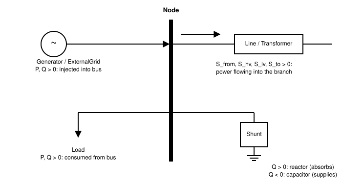
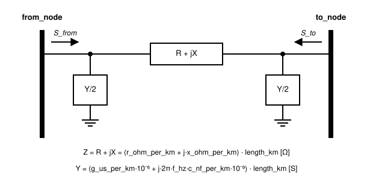
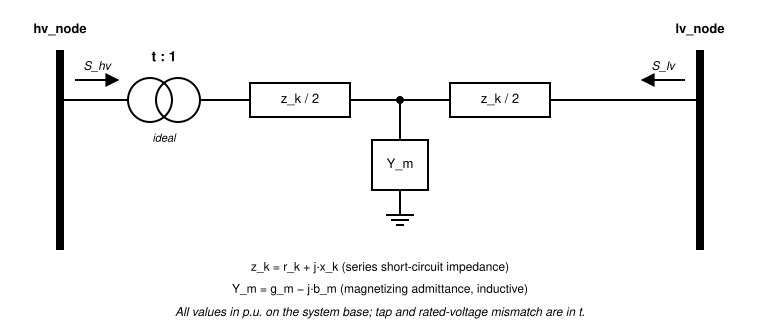

# Case Data Format

Each case is a single JSON file (in [`cases/json/`](../cases/json)). The same data is also provided as an Excel workbook (in [`cases/excel/`](../cases/excel)), where every JSON table is a sheet with the same name and the same columns.

The format follows the pandapower data model, with the table and field names used in this course.

## 1. General structure

The file is one JSON object. Each top-level key is a **table**. Each table is stored **column-wise**: it is an object whose keys are field names and whose values are lists of equal length. Element *i* of a table is formed by taking index *i* from every list.

```json
{
  "Network": { "schema_version": ["v2"], "name": ["IEEE 14"], "base_mva": [100], "f_hz": [60] },
  "Load": {
    "id":     [0, 1],
    "node":   ["Bus 2", "Bus 3"],
    "p_mw":   [21.7, 94.2],
    "q_mvar": [12.7, 19.0],
    "name":   ["Load 0", "Load 1"]
  },
  ...
}
```

Reading a table into a row-oriented structure in Python:

```python
import json

with open("cases/json/ieee14.json") as f:
    case = json.load(f)

loads = case["Load"]
rows = [dict(zip(loads.keys(), values)) for values in zip(*loads.values())]
# rows[0] -> {'id': 0, 'node': 'Bus 2', 'p_mw': 21.7, 'q_mvar': 12.7, 'name': 'Load 0'}
```

(`pandas.DataFrame(case["Load"])` gives the same table as a DataFrame.)

### Tables

| Table | Kind | Description |
|---|---|---|
| `Network` | input | Case-wide parameters (single row) |
| `Node` | input | Buses |
| `ExternalGrid` | input | External grid connection — the slack (reference) bus |
| `Generator` | input | Voltage-controlled generators (PV buses) |
| `Load` | input | Constant-power loads |
| `Shunt` | input | Shunt elements (capacitors / reactors) |
| `Line` | input | Lines |
| `Transformer` | input | Two-winding transformers |
| `Result_Node` | reference result | Bus voltages and net bus power |
| `Result_Line` | reference result | Line flows, losses and currents |
| `Result_Transformer` | reference result | Transformer flows, losses and currents |
| `Result_ExternalGrid` | reference result | Slack power |
| `Result_Generator` | reference result | Generator powers and voltages |
| `Result_Load` | reference result | Load powers |
| `Result_Shunt` | reference result | Shunt powers |

### Conventions

- **References between tables use node names, not ids.** Fields such as `node`, `from_node`, `hv_node` contain the `name` of a row in `Node` (e.g. `"Bus 5"`).
- `id` is a zero-based integer index, unique within its table.
- Units are encoded in the field name suffix: `_mw`, `_mvar`, `_kv`, `_ka`, `_pu`, `_degree`, `_percent`, `_km`, `_ohm_per_km`, `_nf_per_km`, `_us_per_km` (µS/km), `_kw`, `_mva`.
- Powers are three-phase totals; voltages are line-to-line.
- `in_service` is a boolean. Elements with `in_service = false` must be ignored in the analysis.

#### Sign conventions

| Element | Positive value means |
|---|---|
| `Load` `p_mw`, `q_mvar` | power **consumed** from the bus |
| `Generator` `p_mw` | power **injected** into the bus |
| `Shunt` `p_mw`, `q_mvar` | power **consumed** at nominal voltage (negative `q_mvar` → capacitor, positive → reactor) |
| `Result_Node` `p_mw`, `q_mvar` | net power **consumed** at the bus (load-oriented; a generating bus has a negative value) |
| `Result_ExternalGrid`, `Result_Generator` `p_mw`, `q_mvar` | power **injected** into the bus |
| `Result_Load`, `Result_Shunt` `p_mw`, `q_mvar` | power **consumed** |
| Branch flows (`p_from_mw`, `p_hv_mw`, …) | power flowing **into** the branch from that terminal |



---

## 2. Input tables

### 2.1 `Network`

One row with case-wide parameters.

| Field | Type | Unit | Description |
|---|---|---|---|
| `schema_version` | string | – | Format version (currently `"v2"`) |
| `name` | string | – | Case name |
| `base_mva` | number | MVA | System power base used for per-unit conversion |
| `f_hz` | number | Hz | System frequency (needed for line capacitance) |

### 2.2 `Node`

| Field | Type | Unit | Description |
|---|---|---|---|
| `id` | int | – | Bus index |
| `name` | string | – | Bus name; used by other tables to refer to this bus |
| `base_kv` | number | kV | Nominal (base) line-to-line voltage of the bus |
| `node_type` | string | – | Node type; `"b"` = bus |
| `bus_type` | string | – | Load flow bus type: `"slack"`, `"pv"` or `"pq"` |
| `min_vm_pu` | number | p.u. | Lower voltage magnitude limit |
| `max_vm_pu` | number | p.u. | Upper voltage magnitude limit |
| `in_service` | bool | – | Bus in service |

Notes:

- The `slack` bus is the bus that has the `ExternalGrid`; `pv` buses are the buses that have a `Generator`; all others are `pq`.
- The voltage base of each bus is `base_kv`; the impedance base is `Z_base = base_kv² / base_mva` (Ω).
- `min_vm_pu` / `max_vm_pu` are operating limits for evaluating results; they are not constraints of the load flow.

### 2.3 `ExternalGrid`

The slack (reference) bus. Its voltage magnitude and angle are specified; its P and Q are results.

| Field | Type | Unit | Description |
|---|---|---|---|
| `id` | int | – | Index |
| `node` | string | – | Name of the connected bus |
| `vm_pu` | number | p.u. | Voltage magnitude set point |
| `va_degree` | number | deg | Voltage angle set point (reference angle; not necessarily 0) |
| `min_p_mw`, `max_p_mw` | number | MW | Active power limits |
| `min_q_mvar`, `max_q_mvar` | number | MVAR | Reactive power limits |
| `name` | string | – | Name |

### 2.4 `Generator`

Voltage-controlled generator (PV bus): active power and voltage magnitude are specified.

| Field | Type | Unit | Description |
|---|---|---|---|
| `id` | int | – | Index |
| `node` | string | – | Name of the connected bus |
| `p_mw` | number | MW | Active power injection set point |
| `vm_pu` | number | p.u. | Voltage magnitude set point |
| `min_p_mw`, `max_p_mw` | number | MW | Active power limits |
| `min_q_mvar`, `max_q_mvar` | number | MVAR | Reactive power limits |
| `name` | string | – | Name |

Note: the reference results are computed **without** enforcing reactive power limits; generator Q in `Result_Generator` may therefore lie outside `[min_q_mvar, max_q_mvar]`.

### 2.5 `Load`

Constant-power (PQ) load.

| Field | Type | Unit | Description |
|---|---|---|---|
| `id` | int | – | Index |
| `node` | string | – | Name of the connected bus |
| `p_mw` | number | MW | Active power consumption (may be negative) |
| `q_mvar` | number | MVAR | Reactive power consumption |
| `name` | string | – | Name |

A load may be connected to any bus, including PV and slack buses. Several elements may connect to the same bus; their powers add up.

### 2.6 `Shunt`

Constant-admittance shunt element.

| Field | Type | Unit | Description |
|---|---|---|---|
| `id` | int | – | Index |
| `node` | string | – | Name of the connected bus |
| `p_mw` | number | MW | Active power consumed **per section** at rated voltage `nom_u_kv` |
| `q_mvar` | number | MVAR | Reactive power consumed **per section** at rated voltage (negative = capacitive) |
| `nom_u_kv` | number | kV | Rated voltage of the shunt |
| `sections` | int | – | Number of sections in operation |
| `maximum_sections` | int | – | Total number of available sections |
| `name` | string | – | Name |

The shunt is an admittance: its power is `sections × (p_mw + j·q_mvar)` at rated voltage and varies with the square of the actual voltage. In the provided cases `nom_u_kv` equals the bus `base_kv`.

### 2.7 `Line`

Line modeled as a π-equivalent with distributed parameters given per km.

| Field | Type | Unit | Description |
|---|---|---|---|
| `id` | int | – | Index |
| `from_node` | string | – | Name of the from-end bus |
| `to_node` | string | – | Name of the to-end bus |
| `length_km` | number | km | Line length |
| `r_ohm_per_km` | number | Ω/km | Series resistance |
| `x_ohm_per_km` | number | Ω/km | Series reactance |
| `c_nf_per_km` | number | nF/km | Shunt capacitance (total, line-to-ground) |
| `g_us_per_km` | number | µS/km | Shunt conductance (total) |
| `max_i_ka` | number | kA | Thermal current rating (used for `loading_percent`) |
| `in_service` | bool | – | Line in service |
| `name` | string | – | Name |



Total line parameters are obtained by multiplying the per-km values by `length_km`:

- series impedance: `Z = (r_ohm_per_km + j·x_ohm_per_km) · length_km` (Ω)
- total shunt admittance: `Y = (g_us_per_km·10⁻⁶ + j·2π·f_hz·c_nf_per_km·10⁻⁹) · length_km` (S), split equally between the two ends.

Divide by / multiply with `Z_base` of the line's buses to obtain per-unit values.

### 2.8 `Transformer`

Two-winding transformer with an optional tap changer.

| Field | Type | Unit | Description |
|---|---|---|---|
| `id` | int | – | Index |
| `hv_node` | string | – | Name of the high-voltage side bus |
| `lv_node` | string | – | Name of the low-voltage side bus |
| `sn_mva` | number | MVA | Rated apparent power |
| `vn_hv_kv` | number | kV | Rated voltage, HV side |
| `vn_lv_kv` | number | kV | Rated voltage, LV side |
| `vk_percent` | number | % | Short-circuit voltage (magnitude of the series impedance, on the transformer rating) |
| `vkr_percent` | number | % | Real part of the short-circuit voltage (series resistance, on the transformer rating) |
| `pfe_kw` | number | kW | Iron (no-load) losses |
| `i0_percent` | number | % | No-load (magnetizing) current, on the transformer rating; may be negative |
| `shift_degree` | number | deg | Phase shift angle |
| `tap_side` | string | – | Winding with the tap changer (`"hv"` or `"lv"`) |
| `tap_pos` | int | – | Current tap position |
| `tap_neutral` | int | – | Neutral tap position |
| `min_tap`, `max_tap` | int | – | Tap position limits |
| `tap_step_percent` | number | % | Voltage change per tap step |
| `tap_step_degree` | number | deg | Phase angle change per tap step |
| `tap_changer_type` | string | – | Tap changer type (`"ratio"`) |
| `in_service` | bool | – | Transformer in service |
| `name` | string | – | Name |

#### Transformer model

The transformer is represented by an **ideal transformer on the HV side** followed by a **T-equivalent circuit**: the series short-circuit impedance is split into two equal halves, with the magnetizing admittance connected to ground at the middle node.



All quantities below are per unit on the system base (`S_base = base_mva`). `V_b,hv` and `V_b,lv` are the `base_kv` of `hv_node` and `lv_node`.

**Series (short-circuit) impedance** — referred to the LV side:

```
z_k = vk_percent  / 100 · (S_base / sn_mva) · (vn_lv_kv / V_b,lv)²
r_k = vkr_percent / 100 · (S_base / sn_mva) · (vn_lv_kv / V_b,lv)²
x_k = √(z_k² − r_k²)
z_k (complex) = r_k + j·x_k
```

**Magnetizing (shunt) admittance**:

```
y_m = |i0_percent| / 100 · (sn_mva / S_base) · (V_b,lv / vn_lv_kv)²
g_m = pfe_kw / 1000 / S_base · (V_b,lv / vn_lv_kv)²
b_m = √(y_m² − g_m²)
Y_m = g_m − j·b_m
```

`Y_m` is always inductive: the sign of `i0_percent` does not change the model (the IEEE 118 and IEEE 300 cases contain negative `i0_percent` values; use their magnitude). With `i0_percent = 0` and `pfe_kw = 0`, `Y_m = 0` and the T-circuit reduces to the series impedance `z_k`.

**Turns ratio** — the tap changer modifies the rated voltage of the winding given by `tap_side`:

```
n_tap   = 1 + (tap_pos − tap_neutral) · tap_step_percent / 100
V_r,hv  = vn_hv_kv · n_tap   if tap_side == "hv"   else vn_hv_kv
V_r,lv  = vn_lv_kv · n_tap   if tap_side == "lv"   else vn_lv_kv
t       = (V_r,hv / V_b,hv) / (V_r,lv / V_b,lv) · e^(j·shift_degree·π/180)
```

`t` is the off-nominal ratio of the ideal transformer (`t : 1`, HV : LV). It captures both the tap position and any mismatch between the rated voltages and the bus base voltages. In the provided cases all transformers have `tap_side = "hv"`, and `shift_degree` and `tap_step_degree` are 0.

**Equivalent π-circuit** — if your network model uses π-branches, the internal T node can be eliminated with a star–delta transformation (`z_a = z_k / 2` on both sides):

```
z_series = (z_a² + 2·z_a·z_m) / z_m          with z_m = 1 / Y_m
y_shunt  = 1 / (z_a + 2·z_m)                 at each end (on the LV side of the ideal transformer)
```

When `Y_m = 0`, use `z_series = z_k` and `y_shunt = 0`.

Note: some branches that connect buses of different voltage levels in the original IEEE data are represented as transformers; this is why some transformers have small `vk_percent` values or non-zero `vkr_percent` and `i0_percent`.

---

## 3. Reference result tables

These tables contain a converged load flow solution of the case **as given**. Use them to validate your tool. After modifying a case, they no longer apply.

### 3.1 `Result_Node`

| Field | Unit | Description |
|---|---|---|
| `node` | – | Bus name |
| `vm_pu` | p.u. | Voltage magnitude |
| `va_degree` | deg | Voltage angle |
| `p_mw` | MW | Net active power consumed at the bus (load − generation) |
| `q_mvar` | MVAR | Net reactive power consumed at the bus |

### 3.2 `Result_Line`

| Field | Unit | Description |
|---|---|---|
| `line_id` | – | `id` of the line |
| `p_from_mw`, `q_from_mvar` | MW, MVAR | Power flowing into the line at the from end |
| `p_to_mw`, `q_to_mvar` | MW, MVAR | Power flowing into the line at the to end |
| `pl_mw`, `ql_mvar` | MW, MVAR | Losses (`p_from_mw + p_to_mw`, `q_from_mvar + q_to_mvar`); `ql_mvar` can be negative because of line charging |
| `i_from_ka`, `i_to_ka` | kA | Current magnitude at each end |
| `i_ka` | kA | Maximum of `i_from_ka` and `i_to_ka` |
| `vm_from_pu`, `va_from_degree` | p.u., deg | Voltage at the from bus |
| `vm_to_pu`, `va_to_degree` | p.u., deg | Voltage at the to bus |
| `loading_percent` | % | `i_ka / max_i_ka × 100` |

### 3.3 `Result_Transformer`

| Field | Unit | Description |
|---|---|---|
| `transformer_id` | – | `id` of the transformer |
| `p_hv_mw`, `q_hv_mvar` | MW, MVAR | Power flowing into the transformer at the HV side |
| `p_lv_mw`, `q_lv_mvar` | MW, MVAR | Power flowing into the transformer at the LV side |
| `pl_mw`, `ql_mvar` | MW, MVAR | Losses |
| `i_hv_ka`, `i_lv_ka` | kA | Current magnitude at each side |
| `vm_hv_pu`, `va_hv_degree` | p.u., deg | Voltage at the HV bus |
| `vm_lv_pu`, `va_lv_degree` | p.u., deg | Voltage at the LV bus |
| `loading_percent` | % | Loading relative to the rating `sn_mva` (current-based: winding current × rated voltage × √3 / `sn_mva` × 100, larger of the two sides) |

### 3.4 `Result_ExternalGrid`

| Field | Unit | Description |
|---|---|---|
| `ext_grid_id` | – | `id` of the external grid |
| `p_mw`, `q_mvar` | MW, MVAR | Power injected by the slack |

### 3.5 `Result_Generator`

| Field | Unit | Description |
|---|---|---|
| `gen_id` | – | `id` of the generator |
| `p_mw`, `q_mvar` | MW, MVAR | Power injected by the generator |
| `vm_pu`, `va_degree` | p.u., deg | Voltage at the generator bus |

### 3.6 `Result_Load`

| Field | Unit | Description |
|---|---|---|
| `load_id` | – | `id` of the load |
| `p_mw`, `q_mvar` | MW, MVAR | Power consumed |

### 3.7 `Result_Shunt`

| Field | Unit | Description |
|---|---|---|
| `shunt_id` | – | `id` of the shunt |
| `p_mw`, `q_mvar` | MW, MVAR | Power consumed at the actual bus voltage |
| `vm_pu` | p.u. | Voltage at the shunt bus |

### Total losses

The total system losses (a required output of the tool) equal the sum of the branch losses:

```
P_loss = Σ Result_Line.pl_mw   + Σ Result_Transformer.pl_mw
Q_loss = Σ Result_Line.ql_mvar + Σ Result_Transformer.ql_mvar
```

Equivalently, `P_loss = Σ generation (external grid + generators) − Σ loads − Σ shunt consumption`.
